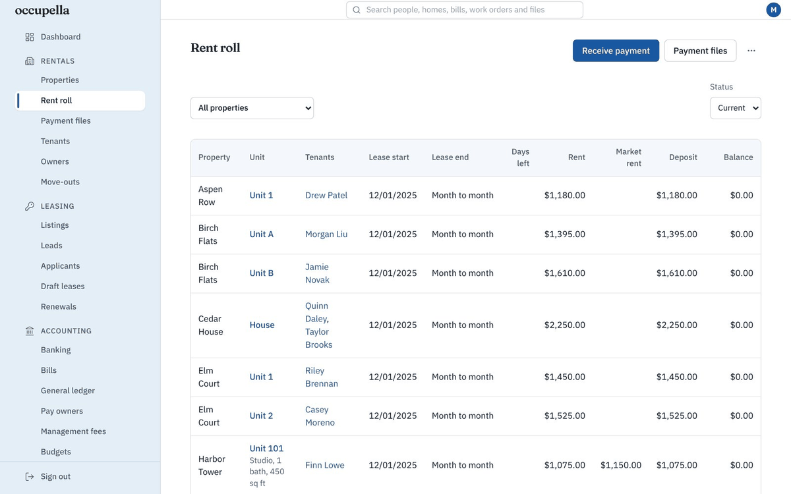
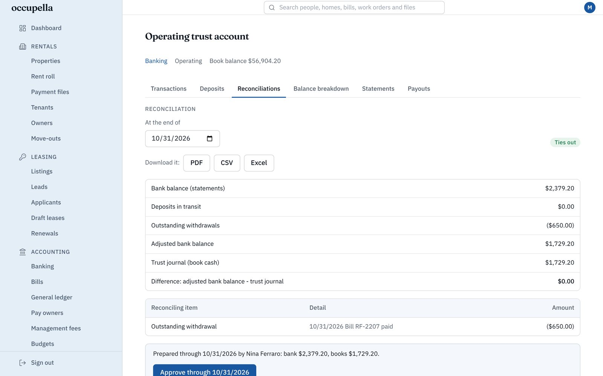
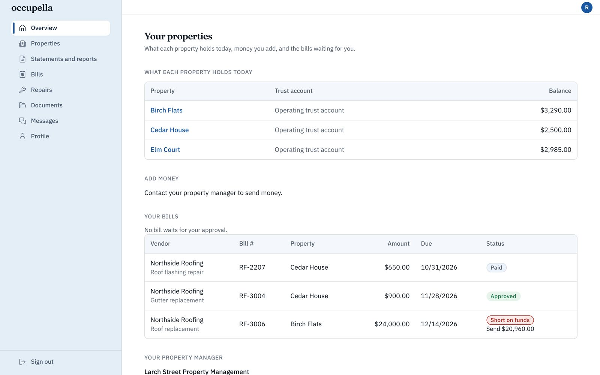
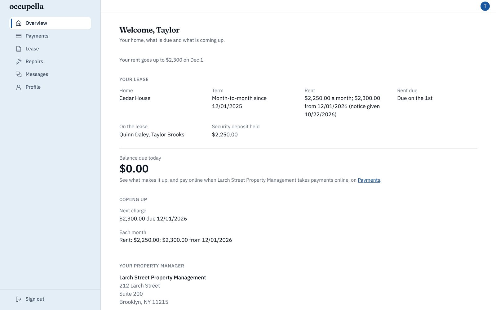

# Occupella PMS

Free, self-hosted property management software with trust accounting enforced by PostgreSQL.

[](https://github.com/brandonoscar/Occupella-PMS/releases)
[](https://github.com/brandonoscar/Occupella-PMS/actions/workflows/ci.yml)
[](LICENSE)

For US property management companies that hold owners' money and tenants' deposits in trust.
It covers the rent roll, leases and e-signing, owner and tenant portals, bills, owner draws and
month-end bank reconciliation, all on an append-only double-entry ledger. You run it, and your
books stay on your server.

> **New in November 2026, and taking on its first companies.** Start with the one-command demo,
> then run a month-end alongside your current system.
> [How the books stay right](docs/proof.md) · [What's built and what's next](docs/status.md)



[Try the demo](#try-the-demo) · [Install](docs/install.md) ·
[Switching from Buildium or AppFolio](#switching-from-buildium-or-appfolio) ·
[Security](SECURITY.md) · [Contributing](CONTRIBUTING.md) · [Changelog](CHANGELOG.md)

## What the database refuses

Each rule is a trigger or a check in `db/migrations/`, not an app setting:

- a save that leaves a trust bank account's cash different from what it holds for owners,
  tenants, vendors and you;
- editing or deleting a posted ledger line (a mistake is fixed with a reversing entry);
- an owner's, tenant's or vendor's balance going below zero, so one owner's money can't pay
  another owner's bill;
- the person who proposed a journal entry posting it, or the person who prepared a month-end
  reconciliation approving it;
- a posting dated in a period that has been reconciled and approved.

Month-end then matches the books to the bank statement: one person prepares it, another
approves it. Where each rule lives and which test holds it: [docs/proof.md](docs/proof.md).

## How the books stay right

- **Every kind of money movement is tested at random.** 85 property-based test suites
  (`tests/properties/`) drive random payments, bounces, bills, draws, fees, deposits and
  month-ends, keep their own model of every balance, and check the database against it after
  each step, on every pull request.
- **Many people at once.** Concurrency tests run 16 workers taking payments, bouncing them,
  paying bills and owners and running rent on one company's books at the same time, and the
  tests that depend on locks run 50 times a night. The write paths take row and advisory locks,
  so two people can't spend the same dollar.
- **Attacks.** Every pull request runs CodeQL, dependency review and secret scanning. OWASP ZAP
  scans the running app daily, a fuzzer throws malformed requests at every endpoint, and
  sign-in is rate-limited with two-step sign-in for staff. Each company's data is kept apart by
  the database's own keys.
- **Backups that restore.** Every pull request backs up a database that holds money, restores
  it into an empty one and checks the ledger still ties out. The self-host stack takes a daily
  dump and CI restores it every night.
- **State law.** Each feature follows the rule every state shares and, where states differ, the
  strictest one found: deposit return deadlines, commingling, notice periods
  ([docs/law.md](docs/law.md)).

**How it stays free.** The self-hosted PMS is Apache-2.0, so the code you run stays yours to
read, change and keep. Occupella's hosted service ([occupella.com](https://occupella.com)) runs
the same code, and its books are free too. It plans to charge for an AI assistant (from $50 a
month) and a small fee on each online rent payment, once both arrive. If you self-host, the
server, email, backups and upgrades are yours to run.

## Screens

Every name and figure below is made up: the screens come from the demo company
(`python -m pms.demo`).

| | |
|---|---|
|  |  |
| **The rent roll.** Every lease, its rent, deposit and balance; receive a payment from the row. | **Month-end.** The bank statement against the trust journal to the cent, prepared by one person and approved by another. |
|  |  |
| **The owner portal.** What each property holds, statements, and bills over their limit to approve or decline. | **The tenant portal.** What they owe and why, payments and receipts, autopay, repairs and messages. |

## Try the demo

You need Docker (Docker Desktop on Windows or a Mac). For the manager's sign-in you also need an
authenticator app on your phone (any app that shows six-digit codes). The demo runs a made-up
company on your own computer, and nothing leaves it.

```sh
git clone https://github.com/brandonoscar/Occupella-PMS.git
cd Occupella-PMS
docker compose -f compose.demo.yaml up --build
```

The first run builds the image from source, which takes several minutes. It then creates the
demo company and prints three sign-in links: a manager, an owner with three properties, and a
tenant. The PMS answers at http://localhost:8100. The links scroll past quickly; to see them
again, run `docker compose -f compose.demo.yaml logs demo`.

1. Open the manager's link, choose a password and add the account to your authenticator app.
2. Last month's reconciliation is prepared and waits for your approval, with a check the bank
   hasn't cleared yet. The Dashboard lists what else waits: a journal entry, the company's fees
   still in trust, a vendor's insurance running out and a lease without renters insurance.
3. Open the owner's and the tenant's links in a private window, so the manager stays signed in.
   They ask for a phone number: any made-up US number, such as 202-555-0123, works, and no text
   is sent.

Payments go to a test page, and emails stay in each person's Email tab. Ctrl+C stops the demo,
and the same command starts it again with the same books. `docker compose -f compose.demo.yaml
down -v` deletes the demo's books, so the next start is fresh. Port 8100 taken? Put
`PMS_DEMO_PORT=8200` in front of the command (in PowerShell, run `$env:PMS_DEMO_PORT = "8200"`
first).

Docker Compose is the supported way to run the demo. To work on the code without Docker, see
[CONTRIBUTING.md](CONTRIBUTING.md).

To run it for a real company, see [docs/install.md](docs/install.md).

## Switching from Buildium or AppFolio

Settings, Import from another PMS, brings a company over from CSV files its old system exports:

- owners, vendors, properties, units, tenants and leases;
- tenants' unpaid charges, each with its own due date;
- vendors' unpaid bills, with their old references and the owner's approval where the old system
  had one;
- each trust bank account's opening balances, checked against the old system's book cash;
- the checks and deposits the bank hadn't cleared at the cutover, until a staff member signs off
  the tie-out;
- what each vendor was paid earlier in the year, for the 1099 summary;
- tenants', owners' and vendors' past lines, kept as history to read. History never posts.

The books start on the cutover day. Nothing before it is posted, and the first reconciliation
starts there.

## What it does

- **Trust accounting:** an append-only double-entry ledger
  ([pgledger](THIRD_PARTY_NOTICES.md)). Owners' money and security deposits sit in their own
  trust bank accounts, and every account ties out at every commit. It does three-way bank
  reconciliation and two-person journal entries, closes years, and keeps an audit log of every
  change.
- **Rent and payments:** rent, recurring charges, prorated months, late fees and NSF fees post
  every night. Staff record payments, import bank and lockbox payment files, and print receipts.
  Tenants pay rent online with autopay through the company's own Stripe account, by bank,
  or by bank or card through Stripe Connect.
- **Owners:** management agreements with reserves and approval limits, and management and
  leasing fees. Owner draws go out by NACHA ACH file or printed check. Owners get statements and
  year-end packages, and an owner portal where they approve bills and pay money in.
- **Bills and vendors:** bills split across expense accounts or shared across properties,
  markups, recurring bills, W-9s, vendor insurance, the 1099 summary, and paying bills by check
  or ACH.
- **Leasing:** a public vacancy page, leads and showings, online applications, lease templates,
  and e-signatures on the PMS's own signing page with a signing certificate. Screening plugs in
  through a partner interface.
- **Tenants:** a tenant portal with the balance, payments, autopay, lease documents, repair
  requests with photos, messages and notice to move out. Deposit returns come with itemized
  statements, and deposit interest is paid where it's due.
- **Affordable housing:** housing assistance split from the tenant's rent (Section 8 vouchers),
  income certifications and inspections, and tax credit (LIHTC) limits and compliance reports.
- **Maintenance:** work orders with priority, photos, visit windows and a link for the vendor.
  Emergencies are emailed to whoever is on call, and jobs can recur.
- **Reports and exports:** income statement (cash and accrual), balance sheet, rent roll,
  delinquency, general ledger, trial balance, budgets and more, as CSV, Excel or PDF. There are
  QuickBooks Desktop and Online exports, and an export of everything.
- **For other software, AI included:** API keys whose database role reads the books and may add
  drafts for staff to approve, but can't post to the ledger. Any MCP client plugs into the MCP
  server at `/mcp`. Events can be read in order or sent to signed webhooks.

Built with Python 3.11, FastAPI, PostgreSQL 16 (plain SQL), React 19, Vite and Tailwind CSS.
Apache License 2.0 (see `LICENSE`). Third-party code and its licenses: `THIRD_PARTY_NOTICES.md`.

## Compared with hosted property management software

| | Occupella PMS | Buildium, AppFolio and similar |
|---|---|---|
| Software license | Free, Apache-2.0 | Monthly subscription |
| Hosting, email, backups and upgrades | Yours to run, or Occupella's hosted version | The vendor's |
| Source code | Open | Closed |
| Trust accounting rules | In the database, with public tests | Not published as code |
| Leaving | Export everything any day, and the software stays yours | Per the vendor's terms |

Buildium and AppFolio are trademarks of their owners. Occupella isn't affiliated with them.

## Running it yourself

**[docs/install.md](docs/install.md)** installs it for a real company. It takes about an hour the
first time.

```sh
git clone https://github.com/brandonoscar/Occupella-PMS.git && cd Occupella-PMS
git checkout v2026.11.0
cp .env.example .env        # your keys: docs/install.md, "Keys you bring"
docker compose -f compose.selfhost.yaml up -d --build
docker compose -f compose.selfhost.yaml exec app \
  python -m pms.admin setup "Your Company LLC" "Your Name" you@example.com
```

Then put HTTPS in front of `127.0.0.1:8000` and open the invite link it prints. Each release's
changes are in [CHANGELOG.md](CHANGELOG.md). [docs/release.md](docs/release.md) covers upgrading
(fixed forward, never rolled back once money is posted), [docs/backup.md](docs/backup.md)
backing up and restoring the books, and [docs/support.md](docs/support.md) who looks when
something fails.

## How it's built

Maintained by [@brandonoscar](https://github.com/brandonoscar), with Claude as the main coding
agent, which is why most commits name it. The money rules live in SQL migrations, so you can
review them apart from the app. Every pull request runs the checks in [docs/CI.md](docs/CI.md),
property-based tests of the ledger among them. [CLAUDE.md](CLAUDE.md) is the agent's full rule
book; [CONTRIBUTING.md](CONTRIBUTING.md) is the short version for people.

If you build on Postgres or care how money software proves itself, a star helps others find it.
